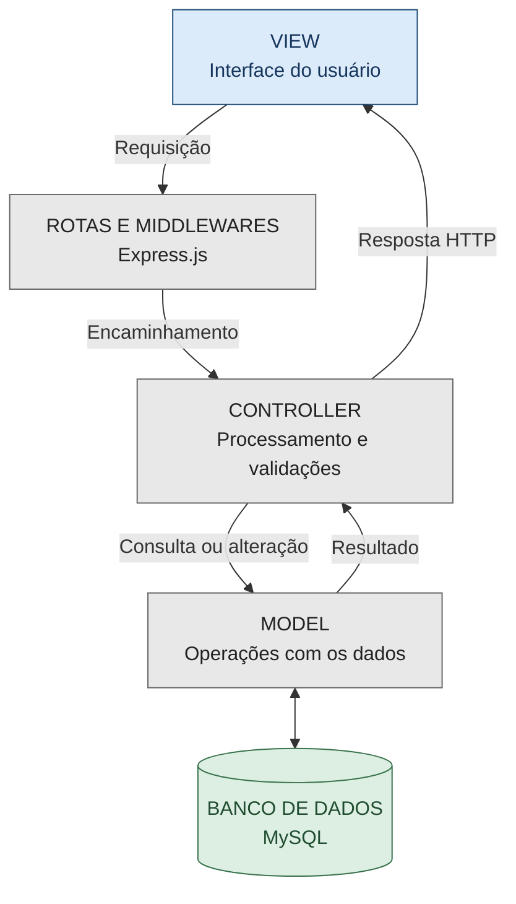

# Arquitetura e Tecnologias

## 1. Arquitetura MVC

O StockMaster utiliza o padrão arquitetural **MVC (Model-View-Controller)**, que separa as responsabilidades da aplicação em três componentes: Model, View e Controller. Essa organização contribui para a manutenção, a organização e os testes do sistema.

- **Model (Modelo):** responsável pelas operações relacionadas aos dados e pela comunicação com o banco de dados MySQL.
- **View (Visão):** responsável pela interface apresentada ao usuário, incluindo telas, formulários e elementos de interação.
- **Controller (Controlador):** responsável por receber e processar as requisições, aplicar validações e coordenar as operações entre as rotas e o Model, retornando as respostas ao cliente.

As rotas e os middlewares do Express.js participam do encaminhamento e do tratamento das requisições antes que elas cheguem aos Controllers, conforme a configuração de cada rota.

## 2. Diagrama da arquitetura

O diagrama representa o caminho geral de uma requisição na aplicação. O Controller aciona o Model quando precisa consultar ou modificar dados, e o resultado é devolvido ao cliente por meio de uma resposta HTTP.

## 3. Tecnologias utilizadas

| Tecnologia | Finalidade |
|---|---|
| HTML | Estrutura das páginas da aplicação. |
| CSS | Estilização e organização visual das interfaces. |
| JavaScript | Interações da interface e lógica executada no servidor. |
| Node.js | Ambiente de execução JavaScript no servidor. |
| Express.js | Gerenciamento de rotas, middlewares e requisições HTTP. |
| MySQL | Armazenamento e gerenciamento dos dados. |
| Jest | Execução de testes automatizados. |

## 4. Validação e tratamento de erros

A aplicação realiza validações de dados e utiliza respostas HTTP para informar o resultado das requisições. O tratamento dos erros considera sua origem, como dados inválidos, falhas nas operações ou problemas de acesso ao banco de dados.

## 5. Links para consulta

Caso queira conhecer melhor a arquitetura MVC e as tecnologias utilizadas no desenvolvimento web, os seguintes sites podem ajudar:

- **Arquitetura MVC:** [Guia para iniciantes — Data Hackers](https://www.datahackers.news/p/arquitetura-mvc-guia-essencial-para-iniciantes-em-desenvolvimento-web)
- **Desenvolvimento web:** [MDN Web Docs](https://developer.mozilla.org/pt-BR/docs/Web)
- **Rotas e requisições:** [Documentação do Express.js](https://expressjs.com/)
- **JavaScript no servidor:** [Documentação do Node.js](https://nodejs.org/learn)
